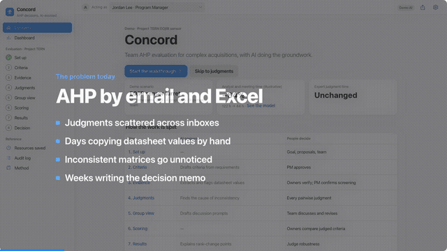
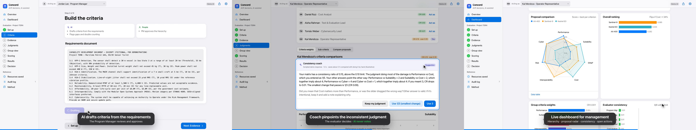

# Concord: AHP decisions, AI-assisted

**Live demo:** https://cweekiat.github.io/concord-ahp/



**[▶ Watch the 30-second demo](docs/demo/demo.mp4)** · By [cweekiat](https://cweekiat.github.io/)



Concord runs a team **Analytic Hierarchy Process (AHP)** evaluation for complex acquisitions, following DoD source selection practice. The AI drafts and checks. People make every judgment, and the Source Selection Authority (SSA) signs the decision.

## What's inside

- **8-step workflow**: set up → criteria → evidence → judgments → group view → scoring → results → decision.
- **Management dashboard** with:
  - progress KPIs and the outstanding actions for each owner
  - an AHP hierarchy diagram (link width shows each criterion's contribution)
  - a radar comparison of the proposals
  - ranking, group weights, evaluator consistency, evidence status and disagreement charts
  - AI oversight counts
- **Demo scenario**: an EO/IR sensor for a maritime patrol UAS. Four fictional proposals and a nine-person team.
- **Resources-saved model**: illustrative and editable.
- **Audit log**: every AI suggestion and every human decision.

All scores and weights come from a deterministic, unit-tested engine (`src/ahp/engine.ts`). The AI only explains numbers the engine has already computed.

## AI: live by default

Open **Settings → AI** and paste a key. The provider is detected automatically.

| You paste | Uses |
|---|---|
| nothing | Local **Ollama `qwen2.5:7b`** (`OLLAMA_ORIGINS="*" ollama serve`) |
| `sk-ant-…` | **Claude Haiku 5.5** |
| `sk-…` | OpenAI |
| `AIza…` | Google Gemini |

- **Demo mode** (scripted, offline) is a switch in Settings.
- **Other endpoints:** *Advanced* lets you pick any provider, endpoint or model, such as LM Studio, vLLM, OpenRouter or an in-house gateway.
- **Keys:** kept in memory unless you choose "Remember key on this device", and never exported.
- **Untrusted replies:** every live AI response is checked and coerced to the expected shape before it's shown.

## Working as a team (no accounts)

1. The PM opens **Share** (toolbar), enters a name and email, and emails each colleague an **invite link** for their role.
2. Each colleague opens the link, joins as that role, and does their part: judgments, verifying evidence, comparisons.
3. They press **Share → Email my input**. This sends a short **response link** containing only their contribution, with a checksum.
4. The PM opens each response link and presses **Merge**. The audit log records who sent what, from which email, and when.

Links carry the data in the URL fragment. Nothing goes to a server. Identities are self-declared. See [docs/ROLLOUT.md](docs/ROLLOUT.md) for the path to verified accounts.

## Demo video and tour

- **Watch demo (30 s)** on the Overview. The source is in `docs/demo/` and was rendered from `docs/demo/storyboard.json` with the `product-demo-video` Claude skill.
- **Take the tour** (10 steps) from the Overview or from Settings.

## Run on your own laptop

Requires Node 20+.

```bash
git clone https://github.com/cweekiat/concord-ahp.git
```

```bash
cd concord-ahp && npm install
```

```bash
npm run dev
```

Then open http://localhost:5173/concord-ahp/.

To preset a provider, for example a local Ollama model, copy `.env.example` to `.env.local` and edit it:

```bash
cp .env.example .env.local
```

```
VITE_LLM_PROVIDER=ollama
VITE_LLM_BASE_URL=http://localhost:11434/v1
VITE_LLM_MODEL=qwen2.5:7b
VITE_LLM_API_KEY=            # local use only; never deploy a build containing a key
```

Other commands: `npm test` runs the engine and output-hardening tests, and `npm run build` builds a static site into `dist/`. You can host that folder anywhere, including an air-gapped intranet server next to a local model.

## Deploy

Pushing to `main` deploys to GitHub Pages via `.github/workflows/deploy.yml`.

## Design

Concord follows Apple's Human Interface Guidelines:

- system font and semantic colours
- light, dark and increased-contrast modes
- 44 px touch targets
- support for reduced motion and reduced transparency

Charts use a validated colour-blind-safe palette with legends, direct labels and a data table under each chart. See [docs/HIG-REVIEW.md](docs/HIG-REVIEW.md).

## Limitations

- Concord runs in a single browser. Team members share an evaluation by exporting and importing a JSON file.
- A real deployment needs accounts, access control, CUI accreditation and an approved model host.
- All demo data is fictional.
